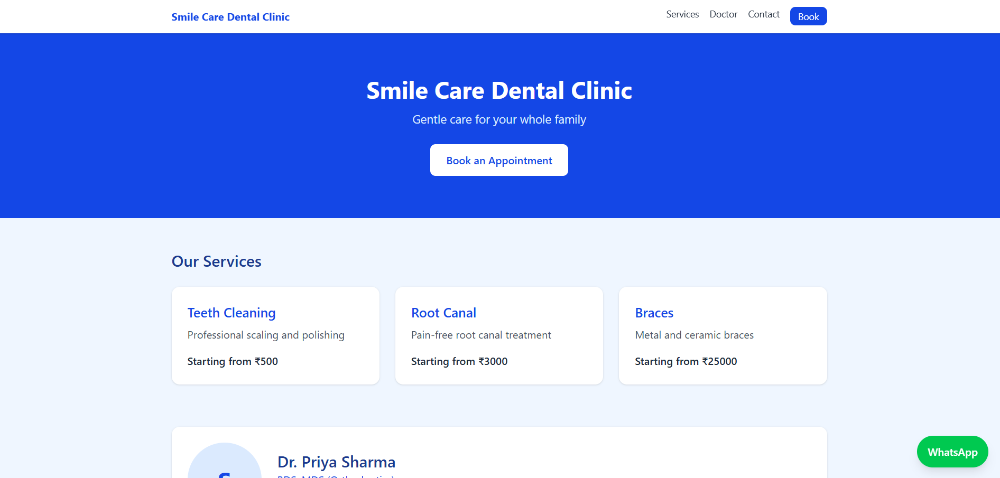
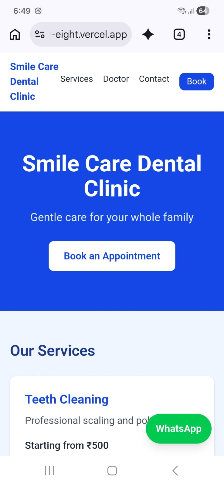
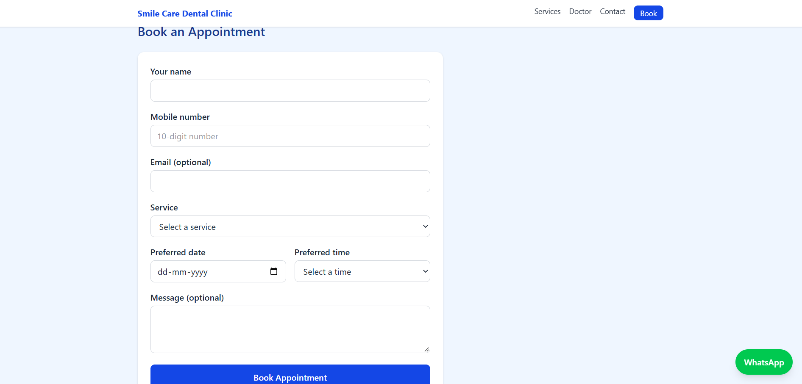
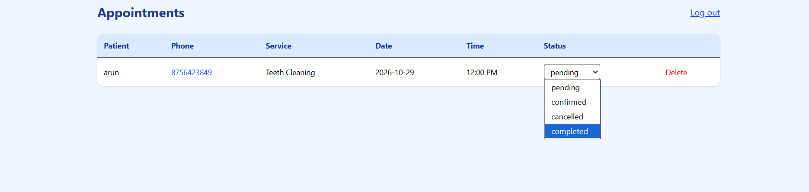

# Smile Care Dental Clinic - Appointment Booking Website

A full-stack website for dental clinics: patients book appointments online,
and the clinic owner manages them from a password-protected dashboard.

**Live demo:** https://YOUR-VERCEL-URL.vercel.app
**Admin demo:** /admin (ask me for demo credentials)

## Features
- Responsive design, mobile-first
- Services loaded from a PostgreSQL database
- Online booking form with server-side validation
- Admin login (bcrypt password hashing + JWT)
- Admin dashboard: view, confirm, cancel, and delete appointments
- WhatsApp chat button and Google Maps directions
- One config file to rebrand for a new clinic

## Tech stack
React, Vite, Tailwind CSS, Node.js, Express, PostgreSQL

## Deployment
Frontend on Vercel, backend on Render, database on Neon

## Screenshots

### Mobile view

## Run locally
1. Clone the repo
2. `cd server && npm install`, create `.env` with `DATABASE_URL`, `JWT_SECRET`, `PORT`
3. `cd client && npm install && npm run dev`